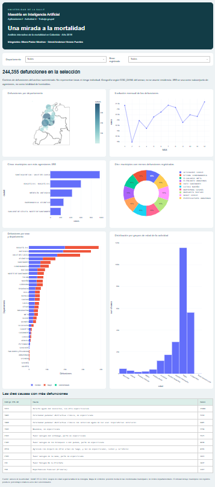

# Mortalidad en Colombia durante 2019

**Integrantes:** Eliana Pastor Merchan y Deivid Anderson Verano Fuentes.

## Introducción del proyecto
Aplicación web construida en Python y Dash para explorar los registros de mortalidad no fetal del anexo académico de 2019. Combina gráficos Plotly con filtros de departamento y sexo registrado.

## Objetivo
Describir la distribución geográfica, temporal, por causa, sexo y grupos de edad de las defunciones. Los resultados son descriptivos: no prueban causalidad ni permiten comparar riesgos sin denominadores poblacionales.

## Estructura del proyecto
- `app.py`: carga de datos, interfaz y callback de actualización de las siete visualizaciones.
- `preparar.py`: lectura y unión de los tres Excel suministrados; agregación con pesos.
- `data/`: datos agregados comprimidos y coordenadas departamentales aproximadas.
- `assets/estilo.css`: estilo adaptable a pantallas pequeñas.
- `requirements.txt`: dependencias compatibles.
- `render.yaml`: configuración del servicio web.
- `capturas/`: evidencias de ejecución local, cuando estén disponibles.
- `COMENTARIO_ENTREGA.md`: integrantes y espacios para las URLs reales una vez publicado.

Los Excel originales se conservan en `fuentes/`. Para reproducir la preparación, ejecute `python preparar.py`. Cada fila del archivo original representa una defunción; no se eliminan filas similares porque no existe una llave individual que justifique deduplicarlas. El archivo agregado conserva el total mediante la columna `casos`.

## Requisitos y software
Python 3.11 o 3.12; Dash 3.x, Plotly 6.x, pandas 2.2.x, openpyxl 3.1.x y Gunicorn 23.x. Los rangos se encuentran en requirements.txt. Git y Visual Studio Code son herramientas de apoyo.

## Instalación
Descargue este proyecto o clone la URL real del repositorio una vez creado. Dentro de la carpeta:

```bash
python -m venv .venv
# Windows
.venv\Scripts\activate
# macOS/Linux: source .venv/bin/activate
python -m pip install -r requirements.txt
python app.py
```

Abra http://127.0.0.1:8050. Los datos preparados ya están incluidos, por lo que no es necesario ejecutar la preparación para iniciar el tablero.

## Despliegue en Render
**Estado: preparado, pendiente de publicación en una cuenta autorizada.**
1. Cree un repositorio GitHub y suba el contenido de esta carpeta, incluidos `data/` y `assets/`.
2. En Render seleccione New → Web Service y conecte el repositorio.
3. Seleccione Python. Comando de construcción: `pip install -r requirements.txt`.
4. Comando de inicio: `gunicorn app:server --bind 0.0.0.0:$PORT --workers 1 --threads 4 --timeout 120`.
5. Revise las condiciones del plan elegido y ejecute el despliegue. También puede usar el Blueprint `render.yaml`.
6. Cuando Render confirme el despliegue, abra la URL pública en una ventana privada y pruebe ambos filtros. Copie la URL real al comentario de entrega junto con la del repositorio.

Estos son pasos de despliegue propuestos, no evidencia de una publicación ya realizada.

## Visualizaciones y explicación de resultados
El conjunto suministrado contiene **244.355 defunciones**. Todos los filtros actualizan los gráficos y la tabla simultáneamente.

### Mapa de símbolos por departamento
Bogotá registra 38.760 casos, Antioquia 34.473 y Valle del Cauca 28.443. Son volúmenes absolutos; no implican mayor riesgo. El tamaño del símbolo representa casos y su ubicación es la media de coordenadas municipales de Divipola, no un centroide oficial. Se utiliza la geografía COD_DANE del archivo sin asumir que corresponde a residencia. El fondo geográfico de Plotly requiere acceso a su recurso cartográfico en línea.

### Línea mensual
Diciembre presenta el máximo con 21.678 registros. Le siguen julio (21.372) y enero (21.354). Un solo año no permite establecer tendencia de largo plazo ni atribuir causas a las variaciones. Los meses se presentan del 1 al 12.

### Cinco municipios con más agresiones X95
La selección incluye todos los códigos que empiezan por X95, incluidos sus subcódigos de cuatro caracteres. Es un subconjunto de agresiones con armas de fuego, no el total de homicidios ni un índice general de violencia. Los empates se resuelven alfabéticamente y el gráfico recalcula el ranking dentro del filtro activo.

### Circular de menor número de defunciones
Presenta los diez municipios con menor conteo positivo en la selección. Los porcentajes se refieren exclusivamente a la suma de esos diez municipios. Se excluyen lugares sin registros: ausencia en el archivo no demuestra cero muertes. Sin población municipal no se puede calcular un índice o tasa comparable; por ello el título utiliza conteos de manera explícita.

### Diez causas principales
Se agrupa por código CIE-10 de cuatro caracteres y se ordena de mayor a menor. I219, infarto agudo del miocardio sin otra especificación, concentra 35.088 registros. J449 presenta 7.210. El agrupamiento a tres caracteres puede producir un orden diferente.

### Barras apiladas por sexo
Se registran 134.573 hombres, 109.689 mujeres y 93 personas con sexo indeterminado. El gráfico conserva esta tercera categoría; no la asigna a hombre o mujer. El sexo registrado no debe interpretarse como identidad de género.

### Histograma por grupos de edad
Se usa exactamente la correspondencia de GRUPO_EDAD1 solicitada: 0–4 neonatal; 5–6 infantil; 7–8 primera infancia; 9–10 niñez; 11 adolescencia; 12–13 juventud; 14–16 adultez temprana; 17–19 adultez intermedia; 20–24 vejez; 25–28 longevidad; 29 desconocida. El histograma suma `casos`, no cuenta filas agregadas. Los intervalos tienen distinta amplitud: no son densidades ni tasas específicas. La categoría infantil de la consigna excluye neonatal y no equivale al indicador epidemiológico de mortalidad infantil menor de un año.

## Validación
Se comprobó que el agregado conserva 244.355 registros y que todos tienen correspondencia geográfica en Divipola. La ruta inicial devolvió HTTP 200. Se ejecutó el callback nacional y con filtros, incluida una selección sin registros, sin errores. La prueba local no acredita disponibilidad pública: falta completar y verificar el despliegue.

## Fuentes
- Archivos Excel de la actividad: NoFetal2019, CodigosDeMuerte y Divipola.
- RED6 Unidad 2, apartados 3.3 y 3.6, material suministrado.
- DANE: https://microdatos.dane.gov.co/index.php/catalog/696
- Dash: https://dash.plotly.com/deployment
- Render: https://render.com/docs/deploy-flask

## Capturas pendientes de incorporar
La instalación del navegador automatizado falló en el entorno de preparación; no se presentan imágenes simuladas como evidencia. Para obtener las capturas reales en su equipo, instale `python -m pip install playwright`, ejecute `python -m playwright install chromium` y luego `python capturar_pantallas.py` con el puerto 8050 libre. El script inicia la aplicación, guarda el tablero completo y cada visualización en capturas/ y cierra el servidor.



Antes de entregar, ejecute el capturador y confirme que todas las imágenes se visualizan en GitHub.
