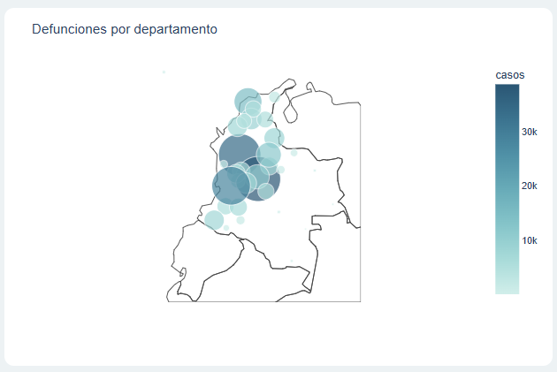
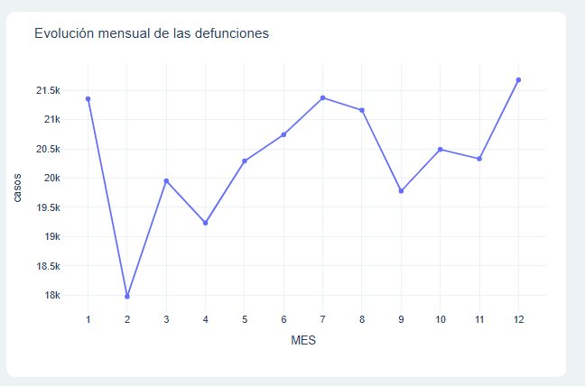
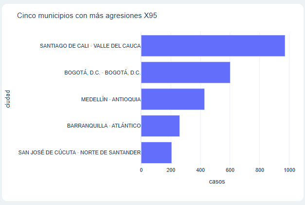
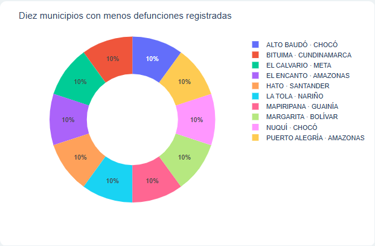
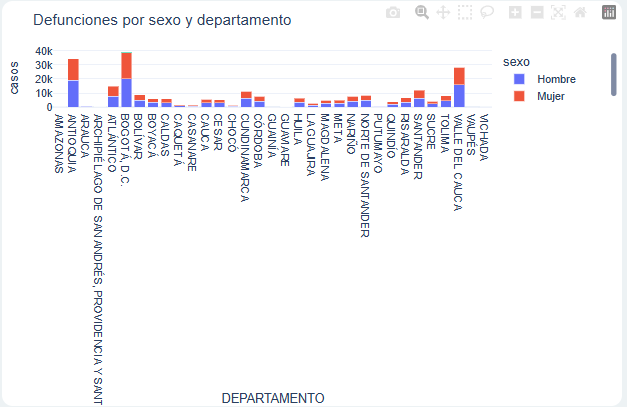
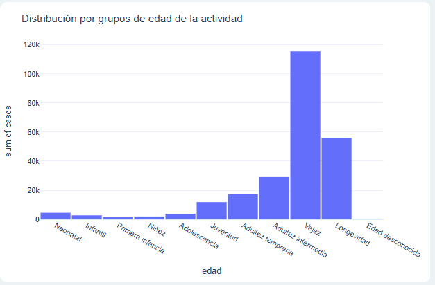
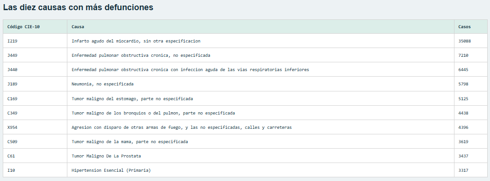

# Universidad de La Salle
## Maestría en Inteligencia Artificial

**Asignatura:** Aplicaciones I  
**Actividad 4:** Aplicación web interactiva para el análisis de mortalidad en Colombia  
**Año académico:** 2026

**Integrantes**
- Eliana Pastor Merchan
- Deivid Anderson Verano Fuentes

# Mortalidad en Colombia durante 2019

## Acceso al proyecto

- **Aplicación web:** https://mortalidad-colombia-o51l.onrender.com/
- **Repositorio GitHub:** https://github.com/deiverf/Mortalidad_Colombia

El tablero está alojado en Render. Para consultarlo basta con abrir el enlace en un navegador; no es necesario instalar Python ni descargar el proyecto.

### Disponibilidad del alojamiento gratuito

Render pone el servicio gratuito en reposo después de 15 minutos sin recibir tráfico. Al abrir nuevamente el enlace, la aplicación se reactiva automáticamente. La primera carga puede tardar unos 50 segundos o más, aproximadamente un minuto. Esta pausa no significa que el proyecto haya sido eliminado.

Según las condiciones consultadas, los servicios web gratuitos no tienen una fecha fija de vencimiento. Su continuidad está sujeta a los límites y condiciones del plan. Cada espacio de trabajo dispone de 750 horas gratuitas por mes, compartidas entre sus servicios; el tiempo en reposo no consume horas. Si se agotan, los servicios gratuitos se suspenden hasta el mes siguiente. También aplican límites de transferencia y construcción.

Para una presentación, conviene abrir el tablero unos minutos antes. Al acceder después de un período sin uso, espere a que finalice el arranque inicial.

Referencia: [Condiciones de los servicios gratuitos de Render](https://render.com/docs/free).

## Introducción del proyecto
Aplicación web construida en Python y Dash para explorar los registros de mortalidad no fetal del anexo académico de 2019. Combina gráficos Plotly con filtros de departamento y sexo registrado.

## Objetivo
Describir la distribución geográfica, temporal, por causa, sexo y grupos de edad de las defunciones. Los resultados son descriptivos: no prueban causalidad ni permiten comparar riesgos sin denominadores poblacionales.

## Estructura del proyecto
- `app.py`: carga de datos, interfaz y callback de actualización de las siete visualizaciones.
- `preparar.py`: lectura y unión de los tres Excel suministrados; agregación con pesos.
- `data/`: datos agregados comprimidos y coordenadas departamentales.
- `assets/estilo.css`: estilo adaptable a pantallas pequeñas.
- `requirements.txt`: dependencias compatibles.
- `render.yaml`: configuración del servicio web.
- `capturas/`: imágenes de las visualizaciones para la documentación.
- `COMENTARIO_ENTREGA.md`: comentario de entrega con integrantes y enlaces del proyecto.

Los Excel originales se conservan en `fuentes/`. Para reproducir la preparación, ejecute `python preparar.py`. Cada fila del archivo original representa una defunción; no se eliminan filas similares porque no existe una llave individual que justifique deduplicarlas. El archivo agregado conserva el total mediante la columna `casos`.

## Requisitos y software
Python 3.11 o 3.12; Dash 3.x, Plotly 6.x, pandas 2.2.x, openpyxl 3.1.x y Gunicorn 23.x. Los rangos se encuentran en requirements.txt. Git y Visual Studio Code son herramientas de apoyo.

## Instalación local opcional

Estos pasos solo son necesarios para ejecutar o modificar el proyecto en el computador. Para consultar la versión publicada, utilice el enlace de Render.

### 1. Obtener el proyecto

En GitHub seleccione **Code → Download ZIP** y descomprima el archivo. Si tiene Git instalado, también puede ejecutar:

```bash
git clone https://github.com/deiverf/Mortalidad_Colombia.git
cd Mortalidad_Colombia
```

Abra una terminal en la carpeta que contiene `app.py` y `requirements.txt`.

### 2. Crear un entorno virtual

Con Python 3.11 o 3.12 instalado:

```bash
python -m venv .venv
```

El entorno virtual mantiene las dependencias del proyecto separadas de otras instalaciones.

### 3. Instalar y ejecutar en Windows

Ejecute cada comando por separado:

```powershell
.\.venv\Scripts\python.exe -m pip install -r requirements.txt
.\.venv\Scripts\python.exe app.py
```

No es necesario activar el entorno porque los comandos utilizan directamente su intérprete.

En macOS o Linux:

```bash
.venv/bin/python -m pip install -r requirements.txt
.venv/bin/python app.py
```

### 4. Consultar el tablero local

Abra http://127.0.0.1:8050 en el navegador del mismo computador. Mantenga abierta la terminal mientras use la aplicación; presione **Ctrl + C** para detenerla.

Los datos preparados están incluidos. No es necesario ejecutar `preparar.py` para iniciar el tablero. Gunicorn se utiliza en el servidor de Render; la ejecución local se realiza con `app.py`.

## Despliegue en Render

La aplicación se aloja como servicio web y utiliza el repositorio GitHub como origen del código. La configuración del proyecto permite reproducir el despliegue con estos pasos:

1. En Render, seleccionar **New → Web Service** y conectar el repositorio `deiverf/Mortalidad_Colombia`.
2. Seleccionar el entorno **Python 3** y la rama que contiene el proyecto.
3. Dejar **Root Directory** vacío cuando `app.py` esté en la raíz.
4. Configurar el comando de construcción:

```bash
pip install -r requirements.txt
```

5. Configurar el comando de inicio:

```bash
gunicorn app:server --bind 0.0.0.0:$PORT --workers 1 --threads 4 --timeout 120
```

6. Iniciar el despliegue y consultar sus registros. Comprobar la carga de gráficos y filtros desde la URL pública.

`server = app.server` expone el servidor Flask de Dash para Gunicorn. El archivo `render.yaml` contiene la configuración para un despliegue mediante Blueprint.

## Visualizaciones y explicación de resultados
El conjunto suministrado contiene **244.355 defunciones**. Todos los filtros actualizan los gráficos y la tabla simultáneamente.

### Mapa de símbolos por departamento
Bogotá registra 38.760 casos, Antioquia 34.473 y Valle del Cauca 28.443. Son volúmenes absolutos; no implican mayor riesgo. El tamaño del símbolo representa casos y su ubicación es la media de coordenadas municipales de Divipola, no un centroide oficial. Se utiliza la geografía COD_DANE del archivo sin asumir que corresponde a residencia. El fondo geográfico de Plotly requiere acceso a su recurso cartográfico en línea.



### Línea mensual
Diciembre presenta el máximo con 21.678 registros. Le siguen julio (21.372) y enero (21.354). Un solo año no permite establecer tendencia de largo plazo ni atribuir causas a las variaciones. Los meses se presentan del 1 al 12.



### Cinco municipios con más agresiones X95
La selección incluye todos los códigos que empiezan por X95, incluidos sus subcódigos de cuatro caracteres. Es un subconjunto de agresiones con armas de fuego, no el total de homicidios ni un índice general de violencia. Los empates se resuelven alfabéticamente y el gráfico recalcula el ranking dentro del filtro activo.



### Circular de menor número de defunciones
Presenta los diez municipios con menor conteo positivo en la selección. Los porcentajes se refieren exclusivamente a la suma de esos diez municipios. Se excluyen lugares sin registros: ausencia en el archivo no demuestra cero muertes. Sin población municipal no se puede calcular un índice o tasa comparable; por ello el título utiliza conteos de manera explícita.



### Barras apiladas por sexo
Se registran 134.573 hombres, 109.689 mujeres y 93 personas con sexo indeterminado. El gráfico conserva esta tercera categoría; no la asigna a hombre o mujer. El sexo registrado no debe interpretarse como identidad de género.



### Histograma por grupos de edad
Se usa exactamente la correspondencia de GRUPO_EDAD1 solicitada: 0–4 neonatal; 5–6 infantil; 7–8 primera infancia; 9–10 niñez; 11 adolescencia; 12–13 juventud; 14–16 adultez temprana; 17–19 adultez intermedia; 20–24 vejez; 25–28 longevidad; 29 desconocida. El histograma suma `casos`, no cuenta filas agregadas. Los intervalos tienen distinta amplitud: no son densidades ni tasas específicas. La categoría infantil de la consigna excluye neonatal y no equivale al indicador epidemiológico de mortalidad infantil menor de un año.



### Diez causas principales
Se agrupa por el código CIE-10 registrado en el archivo, que puede tener tres o cuatro caracteres, y se ordenan las causas de mayor a menor según el número de defunciones. I219, infarto agudo del miocardio sin otra especificación, concentra 35.088 registros. J449 presenta 7.210. 



## Validación
Se comprobó que el agregado conserva 244.355 registros y que todos tienen correspondencia geográfica en Divipola.

## Fuentes
- Archivos Excel de la actividad: NoFetal2019, CodigosDeMuerte y Divipola.
- RED6 Unidad 2, apartados 3.3 y 3.6, material suministrado.
- DANE: https://microdatos.dane.gov.co/index.php/catalog/696
- Dash: https://dash.plotly.com/deployment
- Render: https://render.com/docs/deploy-flask

## Evidencia visual del tablero

La imagen permite consultar la presentación general del tablero. Las interpretaciones de cada gráfico se encuentran en la sección de visualizaciones.

[Ver la captura en GitHub](https://github.com/deiverf/Mortalidad_Colombia/blob/main/capturas/tablero.png)
